<picture>
  <source media="(prefers-color-scheme: dark)" srcset="assets/hero-dark.svg">
  <source media="(prefers-color-scheme: light)" srcset="assets/hero-light.svg">
  
</picture>

Web アプリも、Discord の拡張も、面倒な手作業の自動化も。 
**「動くところまで」をひとりで持っていく**のが、いちばん得意なことです。

Front end · API · data · infra · release — one continuous line.

### SELECTED WORK

**[PingPeek](https://github.com/4uthen7/PingPeek)** — Discord の通知を「どこから来たか」まで見える化するプラグイン。通知音のフックから UI まで自前で、BetterDiscord / Vencord 両対応。

ほかの実験作は [リポジトリ一覧](https://github.com/4uthen7?tab=repositories) に。

### STACK

`TypeScript` `JavaScript` `React` `Node.js` `Electron` `Python` `PowerShell` `Discord API`

### NOW

PingPeek の配布まわりと、Discord クライアント拡張の検証を進行中。

### ELSEWHERE

[GitHub](https://github.com/4uthen7) ・ [X](https://x.com/tkmt_wonderkid) ・ Discord `4uthent_`

この README のヘッダーは SVG で動いています。OS の「アニメーションを減らす」設定では静止します。
